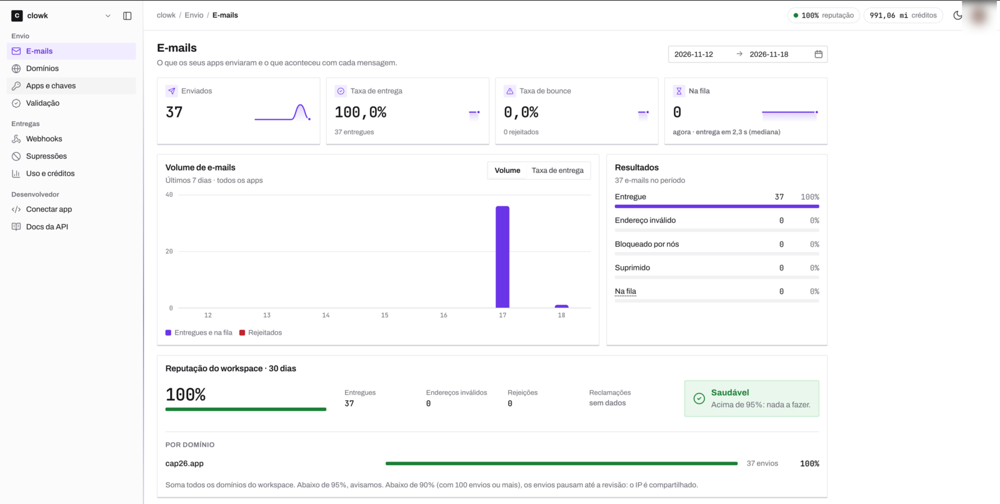
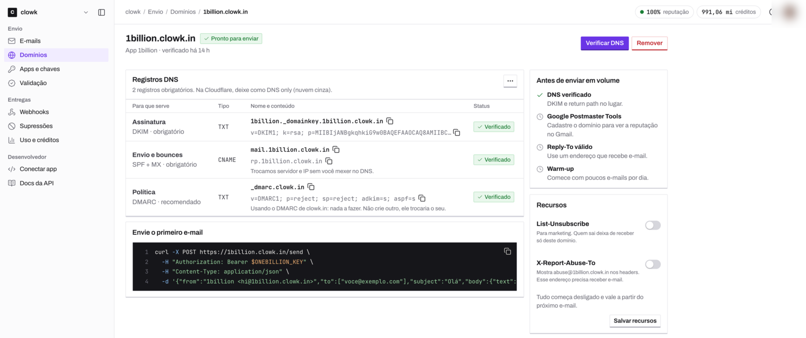
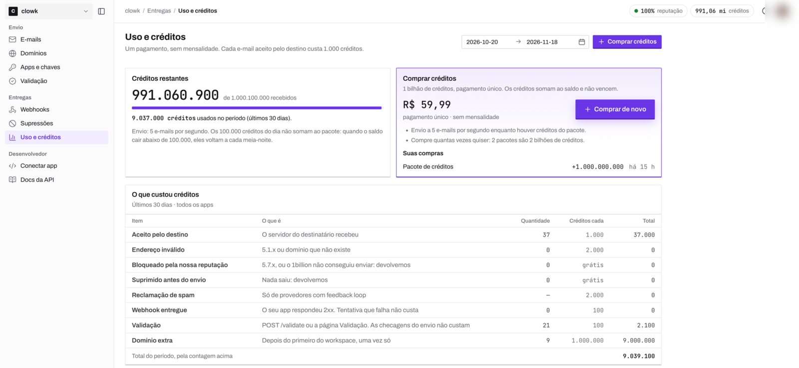

<p align="center">
  <a href="https://1billion.clowk.in">
    <picture>
      <source media="(prefers-color-scheme: dark)" srcset="public/brand/logo-white.svg">
      
    </picture>
  </a>
</p>

<p align="center">
  <b>Transactional e-mail on its own sending servers.</b><br>
  Free forever: 100,000 credits every day, enough for 100 mails.
</p>

<p align="center">
  <a href="https://1billion.clowk.in"><b>Website</b></a> ·
  <a href="https://app.1billion.clowk.in"><b>Start free</b></a> ·
  <a href="https://1billion.clowk.in/docs"><b>Docs</b></a> ·
  <a href="https://1billion.clowk.in/blog"><b>Blog</b></a> ·
  <a href="https://1billion.clowk.in/pt-br/"><b>Português</b></a>
</p>

1billion sends the mail that a person waits for: login codes, magic links, password resets, receipts and
alerts. We run the mail servers (the MTA) ourselves, sign each domain with its own DKIM key, and keep every
message for 30 days, so you can see what happened to it.

- **One API call.** `POST /send`, or one line in Rails. Answer `202` at once, one message for each recipient.
- **Our own MTA.** No relay of another provider. Each domain signs with its own DKIM key, stored encrypted.
- **Checks before the send.** A bad, disposable or role address gets `422` and costs nothing.
- **Follow every mail.** From `accepted` to `sent` or `bounced`, in the console, with one call, or by a signed webhook.
- **Safe retries.** The same `Idempotency-Key` in 30 days never sends a mail twice.
- **Free forever.** 100,000 credits every day. Then 1 billion credits for R$ 59.99, paid once, that never expire.

## Send a mail

```bash
curl https://api.1billion.clowk.in/send \
  -H "Authorization: Bearer $ONEBILLION_API_KEY" \
  -H "Content-Type: application/json" \
  -d '{
    "from": "Acme <hi@acme.com>",
    "to": "jane@example.com",
    "subject": "Your code",
    "body": { "text": "Your code is 482 913" },
    "priority": "high"
  }'
```

In Rails, after `bundle add 1billion` and `ONEBILLION_API_KEY` in the environment:

```ruby
# config/environments/production.rb
config.action_mailer.delivery_method = :onebillion
```

## The console

Each mail, each domain and each credit, in one place.

<p align="center">
  
</p>

<p align="center">
  
  
</p>

## SDKs

Each one is open source (MIT), with no dependencies, and follows the same rules: a retry only of `503` and
network errors, with the same `Idempotency-Key`.

| SDK | Install | Repository |
|---|---|---|
| Ruby and Rails (ActionMailer) | `bundle add 1billion` | [clowk-in/1billion-ruby](https://github.com/clowk-in/1billion-ruby) |
| Node.js, Next.js and Bun | `pnpm add @clowk/1billion` | [clowk-in/1billion-js](https://github.com/clowk-in/1billion-js) |
| Go | `go get github.com/clowk-in/1billion-go` | [clowk-in/1billion-go](https://github.com/clowk-in/1billion-go) |

Any other language calls the HTTP API: see the [API reference](https://1billion.clowk.in/docs/api).

## From the blog

- [Free forever, forever!](https://1billion.clowk.in/blog/free-forever/): why we can give 100,000 credits every day.
- [Move a Rails app from Resend to 1billion](https://1billion.clowk.in/blog/rails-from-resend/): one mailer at a time, with no day where mail stops.

## This repository

This is the website of 1billion: the landing page, the docs and the blog, in English and in Brazilian
Portuguese. The service itself is not here.

```bash
pnpm install
pnpm dev        # http://localhost:3000
pnpm lint && pnpm typecheck && pnpm test && pnpm build
```

Next.js with `output: 'export'`, the docs and the blog in MDX (Fumadocs), and a Cloudflare Worker that serves
the files and picks the language of `/` by country (`worker/`). A `v*` tag deploys.

A fix to the docs is welcome: read [CONTRIBUTING.md](CONTRIBUTING.md). For a security problem, see
[SECURITY.md](SECURITY.md). This project follows a [Code of Conduct](CODE_OF_CONDUCT.md).
